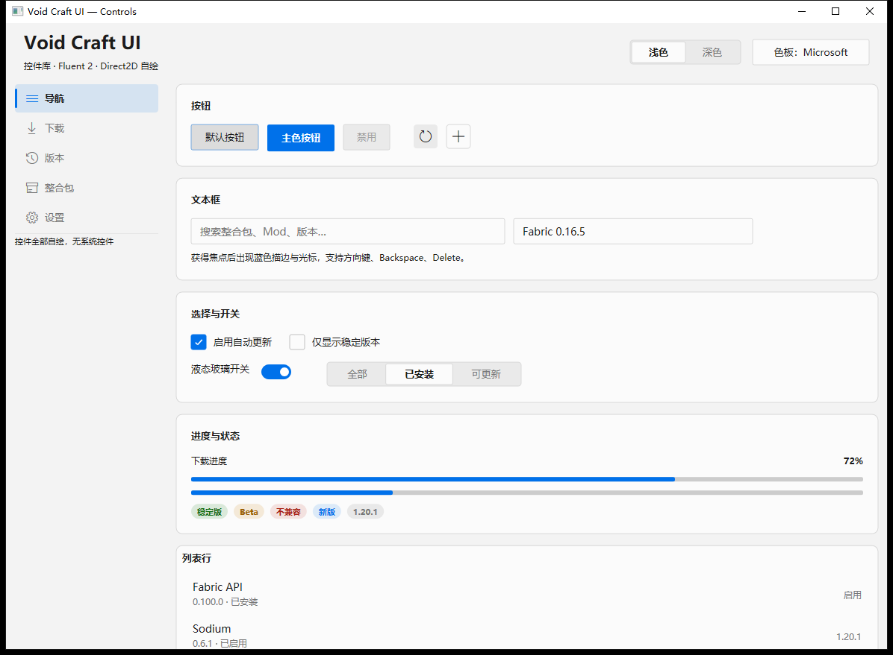
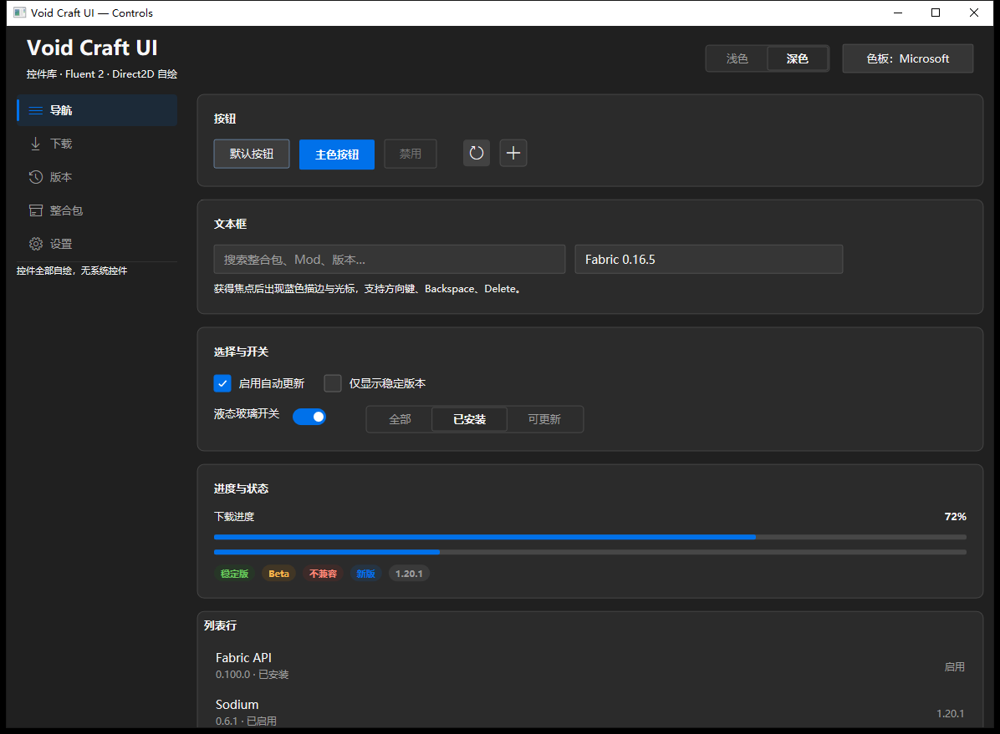
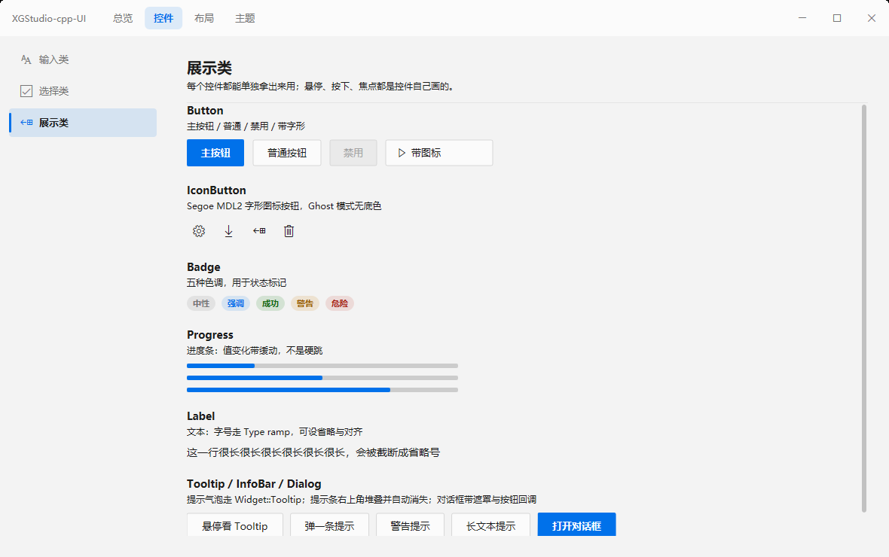
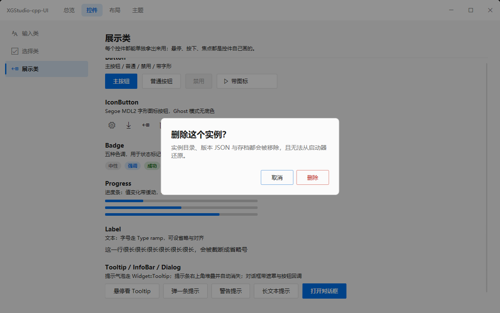

<!--
  Copyright 2026 XGstudio

  Licensed under the Apache License, Version 2.0 (the "License");
  you may not use this file except in compliance with the License.
  You may obtain a copy of the License at

      http://www.apache.org/licenses/LICENSE-2.0

  Unless required by applicable law or agreed to in writing, software
  distributed under the License is distributed on an "AS IS" BASIS,
  WITHOUT WARRANTIES OR CONDITIONS OF ANY KIND, either express or implied.
  See the License for the specific language governing permissions and
  limitations under the License.

  SPDX-License-Identifier: Apache-2.0
-->

# XGStudio-cpp-UI


**C++17 / Direct2D + DirectWrite + Win32 的全自绘控件库。** 窗口里没有任何系统控件——没有 `EDIT`、没有 `COMBOBOX`、没有 `BUTTON`，每一个像素都是 `vcui::Gfx` 用 Direct2D 画出来的。单一 Fluent 2 底座（尺寸走 `Metrics`、颜色走 `Token`、字号走 type ramp），浅/深两档 × Microsoft / GitHub 两套色板。

<table>
<tr>
<td width="50%"></td>
<td width="50%"></td>
</tr>
<tr>
<td align="center"><sub>浅色 · 控件页（输入类）</sub></td>
<td align="center"><sub>深色 · 同一页、同一组控件</sub></td>
</tr>
</table>

截图都来自仓库里的 `VCUIFrameDemo`（控件库展示程序），不是设计稿。

> **关于命名**：项目对外名是 **XGStudio-cpp-UI**（仓库 / 文档 / 示例标题都用它）。代码侧的标识符仍是
> `vcui`：命名空间 `vcui`、CMake 目标 `VCUI::vcui`、产物 `vcui.lib`、宏 `VCUI_*`、环境变量 `VCUI_FPS`
> 等。这样改名不会打断已经在链接它的工程，`find_package(VCUI)` 也照旧可用。

## 目录

- [一行代码起窗口](#一行代码起窗口)
- [API 速查](#api-速查)
- [这套东西特别在哪](#这套东西特别在哪)
- [控件](#控件)
- [布局与容器](#布局与容器)
- [主题与排版](#主题与排版)
- [键盘与焦点](#键盘与焦点)
- [反馈层：提示 / 提示条 / 对话框](#反馈层提示--提示条--对话框)
- [自绘边框窗口](#自绘边框窗口)
- [多窗口](#多窗口)
- [动画](#动画)
- [自定义控件](#自定义控件)
- [性能](#性能)
- [系统要求](#系统要求)
- [构建与集成](#构建与集成)
- [目录结构](#目录结构)
- [调试开关](#调试开关)
- [已知未做](#已知未做)
- [许可](#许可)

## 一行代码起窗口

`CreateAppWindow` 把「DPI 感知 + 自绘边框 + 库自己的标题栏（三系统按钮 + 可拖拽）+ 内容区 + 消息循环」全部包好：

```cpp
#include <windows.h>
#include <vcui/vcui.h>

int WINAPI wWinMain(HINSTANCE, HINSTANCE, PWSTR, int) {
    return vcui::CreateAppWindow(L"我的应用", 960, 640, [](vcui::Widget& body) {
        auto page = vcui::VBox(14.f);
        page->Pad(24.f);
        page->Add(std::make_shared<vcui::Label>(L"Hello", 20.f, 600));

        auto card = std::make_shared<vcui::Card>();
        card->Add(std::make_shared<vcui::Input>(L"输入点什么…"));

        auto btn = std::make_shared<vcui::Button>(L"确定", true);
        btn->Clicked = [] { /* … */ };
        card->Add(btn);

        page->Add(card);
        body.Add(page);          // body = 标题栏下面的内容区，已 Grow=1 铺满
    });
}
```

只要一个空白窗口、不要内容时连回调都可以省：

```cpp
return vcui::CreateAppWindow(L"空白窗口", 720, 480);
```

需要深色、换色板、自定义强调色、不要库的标题栏、窗口最小尺寸时用结构体版本：

```cpp
vcui::AppOptions o;
o.Title  = L"设置";
o.Width  = 900;  o.Height = 620;
o.Dark   = true;
o.Pal    = vcui::Palette::GitHub;
o.Accent = vcui::Hex(0x7C4DFF);
o.TitleBar = false;        // 不要库的标题栏，自己做
o.BodyPad  = 20.f;
o.Build    = [](vcui::Widget& body) { /* … */ };
return vcui::CreateAppWindow(o);
```

`CreateAppWindow` 内部就是：`Surface` → `SetMinSize` / `SetCustomFrame` → `Create` → `Theme::Set` / `SetAccent` → `TitleBar` + 内容 `VBox` → `SetRoot` → 跑共享消息循环。想自己掌控生命周期（多窗口、先建窗再异步灌内容）就直接用 `Surface` / `CreateAppSurface`，两条路径完全等价。

> 入口不叫 `CreateWindow`：`<windows.h>` 把它 `#define` 成 `CreateWindowW`，会撞名。

## API 速查

### Surface（宿主窗口）

建窗、Per-Monitor V2 DPI、帧循环、脏矩形、鼠标 / 键盘 / 输入法路由、焦点、覆盖层。

| API | 说明 |
|---|---|
| `Create(title, w, h, dark)` | 建窗，客户区 `w × h`（DIP） |
| `SetCustomFrame(on)` | 自绘边框窗口（客户区吃掉整窗，边框缩放 / 拖动由库处理）；须在 `Create` 之前调用 |
| `CustomFrame()` / `SetResizeBorder(dip)` | 当前是否自绘边框 / 边框可拖拽宽度（默认 6） |
| `SetMinSize(w, h)` | 窗口最小尺寸，默认 320×200 |
| `SetRoot(widget)` / `Run()` | 设置控件树根 / 进入消息循环 |
| `SetTheme(pal, dark)` / `SetDark` / `SetAccent` / `Th()` | 主题相关，切换时同步 DWM 标题栏明暗 |
| `AddOverlay` / `RemoveOverlay(Deferred)` / `SetDismiss(fn, owner)` | 覆盖层（下拉、弹层、对话框）与点外部关闭 |
| `Invalidate()` / `InvalidateRectD(rc)` / `KickAnim()` | 整窗重绘 / 局部重绘 / 唤醒帧循环 |
| `ClientSize()` | 客户区尺寸（DIP），覆盖层定位用 |
| `ShowInfoBar` / `CloseInfoBars` / `SetInfoBarWidth` | 右上角提示条 |
| `Focused()` / `SetFocus(w)` | 键盘焦点；`SetFocus` 会自动把控件滚进最近的 `ScrollView` |
| `Animating()` / `Pump(dt)` | 供共享消息循环使用（见「多窗口」） |

### Widget（控件树）

一棵树，每个节点自己算尺寸、自己画。布局参数全是公开字段：

- 尺寸：`W` / `H`（`<0` 表示按内容或由容器决定）、`Grow`、`Basis`
- 间距：`ML` / `MT` / `MR` / `MB`（外边距）、`PL` / `PT` / `PR` / `PB`（内边距），`Pad(v)` / `Margin(v)`
- 行为：`Visible`、`Enabled`、`Interactive`（命中目标）、`Clip`、`Opacity`、`Caption`（窗口拖动区）
- 焦点：`Focusable()`（默认 false，重写成 true 才进 Tab 队列）、`Focus`、`FocusRing`（是否画库统一焦点环，默认 true）
- 动画读数：`HoverA()`、`PressA()`、`AnimDirty`
- 事件：`Clicked`，以及可重写的 `OnClick` / `OnClickAt` / `OnDrag` / `OnChar` / `OnKeyDown` / `OnFocus` / `OnWheel` / `OnImeMessage` / `CursorAt`

## 这套东西特别在哪

- **真的全自绘**：光标、选区、滚动、下拉弹层、滑块手柄、开关滑块、导航指示条、阴影、圆角描边全是 `Gfx` 画的，没有任何 `CreateWindowEx` 子窗口，也没有 Owner-Draw 混着系统控件画。
- **输入法是真接管了**：`Input` 处理 `WM_IME_STARTCOMPOSITION / COMPOSITION / ENDCOMPOSITION`，`ImmSetCompositionWindow` 把组合串摆在光标下、`ImmSetCandidateWindow` 把候选窗摆到光标附近；组合串在控件内带下划线渲染，光标随组合串推进。自绘文本框里这块最容易做残，本库是完整实现的。
- **没有 D2D 1.1 / Effect Graph / Acrylic / Mica 依赖**：只用 Direct2D 1.0 的 `ID2D1BitmapRenderTarget`，阴影是 4 层缩放的圆角位图叠加（带缓存），不碰 `ID2D1Effect`，不需要 D3D11 设备。
- **键盘能走全套**：`Tab` / `Space` / 方向键 / `F4` / `Esc` 已经在所有控件上接通，焦点环按 Fluent 的 focus-visible 规则只在键盘操作时出现。
- **闲置真的不烧 CPU**：有动画时跟 `DwmFlush` 合成节拍走，没动画就挂起等消息，实测空闲帧增量为 0、CPU 0%。
- **单文件分发**：默认静态库，`VCUI_STATIC_RUNTIME=ON` 时连 MSVC 运行时一起静态链接，产物只剩自己的 exe。

## 控件

`include/vcui/Controls.h` 一共 17 个控件，全部自绘、全部走同一套 Token/Metrics：

| 控件 | 关键字段 / 回调 |
|---|---|
| `Label` | `Text`、`Size`、`Weight`、`LineHeight`(0=按 type ramp)、`UseType(Type::Body1)`、`Color`、`Align`、`VAlignMode`、`Wrap`(真换行)、`Ellipsis`(超宽尾截断加「…」) |
| `Button` | `Text`、`Glyph`(Segoe MDL2)、`Primary`、`Danger`(红字描边，悬停/按下变红底白字)、`MinWidth`、`Clicked` |
| `IconButton` | `Glyph`、`GlyphSize`、`Ghost`(无底色，悬停才亮)、`Clicked` |
| `Checkbox` | `On`、`Text`、`Changed(bool)` |
| `Switch` | `On`、`Changed(bool)`；滑块位置带缓动 |
| `Input` | `Text`、`Placeholder`、`Caret`、`SelAnchor`、`MaxWidth`、`Changed(str)`、`Submitted` |
| `Slider` | `Value`(0..1)、`Changed(float)`；点轨道即吸附，键盘可步进 |
| `Progress` | `Value`(0..1)，值变化带缓动；`Indeterminate = true` 切不确定态——一段 accent 在轨道里来回循环，不用手动喂进度 |
| `Segmented` | `Items`、`Active`、`Changed(int)`；选中胶囊在段间滑动 |
| `Badge` | `Text`、`ToneKind`（Neutral / Accent / Success / Warning / Danger） |
| `NavItem` | `Text`、`Glyph`、`Active`、`Clicked`；**同一父容器下自动构成单选组**（点谁谁亮、兄弟熄灭） |
| `ListRow` | `Title`、`Sub`、`Right`、`Selected`、`Clicked` |
| `Dropdown` | `Items`、`Selected`、`MenuWidth`、`Changed(int)`；菜单挂在 Overlay 层，可超出窗口边界 |
| `Tooltip` | 一般不用手动建：给任意控件设 `Widget::Tooltip = L"…"`，悬停 600ms 由 Surface 弹出 |
| `InfoBar` | 由 `Surface::ShowInfoBar(text, tone, 秒)` 创建；右上角堆叠、统一宽度、超宽省略 |
| `Dialog` | `Dialog::Open(host, 标题, 正文, actions, 点遮罩是否关闭, 卡片宽)`；全屏遮罩 + 居中卡片 |
| `TitleBar` | `Title`、`BtnWidth`、`ShowMinimize/Maximize/Close`、`Fill`、`OnCloseRequested`、`NavItems/NavIndex/NavCentered/NavGap/NavChanged` |



## 布局与容器

| 容器 | 说明 |
|---|---|
| `VBox(gap)` / `HBox(gap)` | 一维栈；主轴按 `Basis`/内容取值，剩余空间按 `Grow` 分配；交叉轴 `Cross = Start/Center/End/Stretch`（默认 Stretch） |
| `Card` | 底色 + 圆角 + 描边 + 投影，`Shadow` / `Border` / `Radius` / `Fill` 可关 |
| `Grid(cols, gap)` | 等宽网格，行高取该行最高的子项（信息卡、磁贴布局） |
| `ScrollView` | 单子项纵向滚动；滚轮带缓动、**自带自绘滚动条**（静默 2px，悬停/滚动时变粗，可拖拽） |
| `Absolute` | 子项用 `X/Y/W/H` 绝对定位 |
| `Spacer(size)` / `Divider()` | 留白（`size=0` 时 `Grow=1` 撑满）/ 1px 分隔线（`Vertical` 可竖排） |

三条布局规则，都是设计上刻意定的：

1. 尺寸三态：`W/H > 0` 是硬尺寸，`< 0` 交给内容或容器，`Grow` 参与主轴剩余空间分配。
2. 子项一律夹在容器内容区里（`Stack::LayoutCol/Row` 会夹 `fr.bottom`/`fr.right`）。否则某一项算大了会把兄弟顶出窗口。
3. `Desired` 返回真实内容尺寸并夹到可用尺寸，不返回"可用尺寸"本身——否则父容器以为子项已占满，`freeSpace` 直接变 0，`Grow` 分配就失效。

## 主题与排版

`Theme` 三件套：`pal`（色板）、`dark`（明暗）、`accent`（强调色）；`Refresh()` 后得到 `t`（Tokens）与 `m`（Metrics）。

```cpp
app.SetTheme(Palette::GitHub, /*dark=*/true);
app.SetAccent(Hex(0xFF6A00));   // accentHover / accentPress / accentSoft / accentSel 全部按比例重算
```

### Token

命名沿用拼音缩写（历史原因），前四列是 `Palette::Microsoft` / `Palette::GitHub` 在浅色与深色下的实际取值：

| Token | 语义 | MS 浅 | MS 深 | GH 浅 | GH 深 |
|---|---|---|---|---|---|
| `kp` | 卡面 / 控件底色（key surface） | `fbfbfb` | `2b2b2b` | `ffffff` | `0c1117` |
| `bj` | 页面背景（background） | `f3f3f3` | `202020` | `f5f8fa` | `000409` |
| `xt` | 悬停填充 / 禁用控件底 | `eaeaea` | `2d2d2d` | `f2f3f5` | `1e242a` |
| `wz` | 主文字（文字） | `1b1b1b` | `f7f7f7` | `1e2328` | `eef6fc` |

派生 Token（随 accent 与明暗自动算，不需要手填）：

| Token | 语义 | 浅色算法 | 深色算法 |
|---|---|---|---|
| `accent` | 强调色 | 默认 `#0071EA`，可 `SetAccent` 覆盖 | 同左 |
| `accentHover` | 强调色悬停 | `Lighten(accent, 8%)` | 同左 |
| `accentPress` | 强调色按下 | `Darken(accent, 10%)` | 同左 |
| `onAccent` | 强调色上的文字 | 按亮度自动取黑/白 | 同左 |
| `accentSoft` | 强调色淡底（选中导航、徽章） | `accent @ 12%` | 同左 |
| `accentSel` | 强调色选中底（列表行） | `accent @ 18%` | 同左 |
| `text2` | 次级文字 | 主文字混向背景 45% | 同左 |
| `text3` | 三级文字 / 禁用文字 | 主文字混向背景 65% | 同左 |
| `border` | 控件描边 | 主文字混向卡面 84% | 白 `@14%` |
| `divider` | 分隔线 | 主文字混向卡面 90% | 白 `@8%` |
| `pressed` | 按压叠色 | 悬停底混向主文字 7% | 同左，8% |
| `panel` | 卡面与页面之间的过渡面 | 卡面混向背景 14% | 同左 |

`Theme::m` 是 Fluent 2 度量（圆角、控件高、行高、字号、字体族、描边宽度），改这里就能整体换皮：`radiusBtn` / `radiusInput` / `radiusCard` / `radiusPanel`、`controlH` / `rowH` / `gap` / `padCard`、`fCaption` / `fLabel` / `fBody` / `fSub` / `fHeading` / `fTitle`、`borderW`、`family`。

### 排版（Fluent type ramp）

字号不是裸数字，而是走官方 type ramp：每档自带**字号 / 字重 / 行高**，`Label` 默认按字号自动取行高（`LineH(px)`），所以 32px 标题的行高是 40，而不是 1.55 倍。

```cpp
using namespace vcui;
auto t2 = std::make_shared<Label>();
t2->UseType(Type::Body1);                      // 14 / 20 Regular
```

| 档 | 字号/行高 | 字重 | 用途 |
|---|---|---|---|
| `Caption2` | 10 / 14 | 400 | 角标、极小注脚 |
| `Caption1` / `Caption1Strong` / `Caption1Stronger` | 12 / 16 | 400 / 600 / 700 | 辅助文字、表格副值 |
| `Body1` / `Body1Strong` | 14 / 20 | 400 / 600 | 正文、表单值 |
| `Subtitle2` | 16 / 22 | 600 | 小标题 |
| `Subtitle1` | 20 / 26 | 600 | 区块标题 |
| `Title3` / `Title2` / `Title1` | 24 / 32、28 / 36、32 / 40 | 600 | 页面 / 实例主标题 |
| `LargeTitle` / `Display` | 40 / 52、68 / 92 | 600 | 大屏头图 |

非标准字号（13、17…）由 `TypeFor(px)` 兜底：落到最近一档并按比例缩放行高。文案遵循 Fluent 的内容规范：句式大小写（sentence case），不用全大写博眼球。

## 键盘与焦点

开箱可用，不用在每个控件里自己写焦点逻辑：

| 键 | 行为 |
|---|---|
| `Tab` / `Shift+Tab` | 在可聚焦控件间移动焦点（只走 `Focusable()` 为真的），顺序就是树序；焦点落到视口外时最近的 `ScrollView` 会自动滚过去 |
| `Space` / `Enter` | 激活 `Button` / `IconButton` / `NavItem`；`Checkbox` / `Switch` 用 `Space` 切换 |
| `←` `→` `↑` `↓` | `Slider` 步进 1%（按住 `Shift` 10%）、`Segmented` 换段、`Dropdown` 展开后换选中项、侧栏 `NavItem` 在单选组里上下移动 |
| `Home` / `End` | 值到两端 / 段跳到首尾 / 滚动到顶底 |
| `PgUp` / `PgDn` | 滑块 10% 步进、滚动容器翻页 |
| `F4` / `Alt+↓` | 展开或收起下拉框（Windows 惯例键） |
| `Esc` | 先收起最上层弹层 / 对话框；没有弹层时转发给焦点控件 |

- 焦点环由库统一画：控件框外扩 2px 的 2px `accent` 描边，整棵树画完之后叠加，并夹到最近的 `Clip` 容器里（不会画到滚动容器外面）
- 只有**键盘焦点**才画环（focus visible）：鼠标点出来的焦点照样能收到键盘事件，但不画环；一按键盘（Tab / 空格 / 方向键 / 字母）就切进键盘焦点模式开始画
- 自带焦点视觉的控件关掉了它（`FocusRing = false`）：`Input`（聚焦是 accent 描边 + 光标，这是输入框的常规视觉）、`Dropdown`（展开/聚焦是 accent 描边）、`ScrollView`、`Dialog`
- 窗口失焦（`WM_ACTIVATE`）时不画环，切回来再画
- 控件被销毁时会自动从宿主的 悬停 / 按下 / 焦点 / 提示 槽里摘掉，所以「切页时重建子导航」「重建整页」都不会留下悬空指针
- 有模态（`FillHost` 覆盖层，比如对话框）时 `Tab` 只在这一层里转，跑不到被遮罩盖住的页面；对话框打开时焦点落在主按钮，回车即确认
- 自定义控件想进 Tab 顺序：`bool Focusable() const override { return true; }`，再实现 `OnKeyDown(vk)` 处理 `VK_SPACE` / `VK_RETURN`

## 反馈层：提示 / 提示条 / 对话框

三者都是覆盖层，不参与页面布局，深色浅色都跟着 Token 走：

```cpp
// 悬停提示：给控件一句话，Surface 负责延时、定位（下面放不下会自动翻到上面）
btn->Tooltip = L"删除前会再确认一次";

// 提示条：右上角堆叠，3 秒后淡出
app.ShowInfoBar(L"已保存到本地", InfoTone::Success, 3.f);

// 对话框：模态遮罩，标题 + 自动换行的正文 + 按钮行
Dialog::Open(&app, L"删除这个实例？", L"实例目录、版本 JSON 与存档都会被移除。",
             { DialogAction{ L"取消" },
               DialogAction{ L"删除", false, /*danger=*/true, []{ /* 真删 */ } } });
```



实现要点：

- 提示条计时靠 `WM_TIMER`，静止时没有帧循环也不会卡住；淡入淡出走 `Opacity`，右侧 24dip 滑入；悬停暂停计时
- 提示条统一宽度（`app.SetInfoBarWidth(360)`，默认 360），文字超出用「…」截断；被截断那条自动带 `Tooltip = 全文`，悬停即可看全
- 对话框覆盖层设 `FillHost = true`，每次绘制按当前客户区重排，窗口缩放时遮罩和卡片自动居中；正文 `Wrap` 按卡片宽度实际排版量高
- 遮罩本身 `Interactive = true`，点击不会穿透到下面；点卡片内部不算"外面"，遮罩不会误关
- `Esc` 走 Surface 的 dismiss 通道，关闭时不会残留 `dismiss_`

## 自绘边框窗口

```cpp
vcui::Surface app;
app.SetMinSize(980, 620);
app.SetCustomFrame(true);               // 客户区吃掉整窗，系统标题栏消失
app.Create(L"我的应用", 1180, 740);

auto root = std::make_shared<vcui::Widget>();
auto bar  = std::make_shared<vcui::TitleBar>();
bar->Title = L"我的应用";
bar->Fill  = true;
root->Add(bar);                          // 高 40，右上角三个系统按钮

auto body = vcui::HBox(0.f);
body->Grow = 1.f;                        // 占满标题栏以下
root->Add(body);
app.SetRoot(root);
```

顶栏要放导航（整栏或最小居中）时：

```cpp
bar->NavItems    = { L"总览", L"控件", L"布局", L"主题" };
bar->NavIndex     = 0;
bar->NavCentered  = true;               // false = 紧跟标题右侧铺开
bar->NavChanged   = [](int i) { /* 切页 */ };
```

保留 `WS_CAPTION | WS_THICKFRAME` 让 DWM 继续提供投影、吸附与最大化动画，再用 `WM_NCCALCSIZE` 吃掉非客户区；边缘缩放由库自己做命中测试（`SetResizeBorder` 调宽度），拖动靠 `Caption = true` 的子树。最大化图标会在 `TitleBar::Paint` 里跟随窗口状态切换。

不想用库的标题栏、只想自己做一条可拖的 header 时，把 `Caption` 设到自己的容器上就行：

```cpp
auto header = std::make_shared<vcui::HBox>(0.f);
header->Caption = true;      // 整条当窗口拖动区
```

## 多窗口

同进程开多个窗口、共用一条消息循环，关掉一个不会带走整个进程：

```cpp
auto w1 = CreateAppSurface({ .Title = L"主窗口", .Width = 900, .Height = 600, .Build = BuildA });
auto w2 = CreateAppSurface({ .Title = L"面板",   .Width = 420, .Height = 260, .Build = BuildB });
return RunAppLoop();      // 最后一个窗口关掉才返回
```

- `CreateAppSurface` 只建窗、不阻塞；返回的 `Surface` 要一直持有到 `RunAppLoop` 返回（窗口靠它活着）
- 一条循环里所有窗口一起推帧：`Animating()` 的窗口各自 `Tick`、各自 `UpdateWindow`，每帧只 `DwmFlush()` 一次对齐合成节拍
- `WM_DESTROY` 里按窗口计数，最后一个才 `PostQuitMessage`；`QuitApp()` 一次性关掉全部窗口
- `AppOptions::Build` 在树挂载之后执行，回调里 `body.Host` / `body.GFX` 已经就绪（可以查主题、挂弹层、再开新窗口）
- 单窗口用 `CreateAppWindow` / `Surface::Run` 时走的也是这条共享循环（`Run()` 内部就是 `RunAppLoop()`）

示例程序：`VCUIMultiWin`（启动即两个窗口，主窗口里能再开新的、也能一键退出全部）。

## 动画

渲染是消息驱动 + 脏矩形，**不在点击回调里同步画**：事件回调只改控件树、标脏，真正的绘制发生在 `WM_PAINT`；有动画时帧循环自建（`Tick → UpdateWindow → DwmFlush` 60fps），静止后自动睡回 0% CPU。

```cpp
content->StaggerIn();            // 默认：单项 252ms，行间错峰 40ms（上限 240ms）
content->FadeIn(.252f, 8.f);     // 或者整块一起入场
row->FadeIn(.252f, 8.f, .12f);   // 单项 + 指定延迟
```

- 时长为**每个控件**从出现到归位的时间，252ms 是 Fluent 的常用入场值；错峰后整页总时长 = 252ms + 最后一项延迟
- 缓动是 `EaseDecelerate(p)`，即 `cubic-bezier(0.1, 0.9, 0.2, 1)`：起步快、收尾慢；按 x 反解贝塞尔参数后取 y，实测 `e(0)=0` / `e(0.5)=0.97` / `e(1)=1`
- `FadeIn(dur, dy, delay)` 把 `Opacity` 从 0 推到 1，同时临时改写 `MT` 做位移；延迟期内保持透明，动画结束时两个字段精确恢复原值
- `StaggerIn` 给直接子项依次加延迟；遇到 `ScrollView` 会下钻一层，让列表里**每一行**各自错峰
- 会自动 `PlayAnim()` 唤醒帧循环；不调它的话循环在静止状态是睡着的
- 每项动画都会把自己标成 `AnimDirty`，`Tick` 只重绘那一块（含 28px 阴影余量）

一部分控件自带持续动画，不需要外部驱动：

```cpp
auto p = std::make_shared<Progress>();
p->Indeterminate = true;    // 不确定态：一段 accent 在轨道里左右往返（单趟 1s），Value 不参与绘制
```

`Indeterminate` 打开后 `Progress::Update` 每帧都返回 true，所在窗口会一直保持 60fps（其它控件都静止也不会睡）。这是预期行为——不确定进度本来就是持续动画。切页 / 销毁后自动恢复空闲。

## 自定义控件

```cpp
class MyChip : public vcui::Widget {
public:
    MyChip() { H = 28.f; Interactive = true; }
    D2D1_SIZE_F Desired(float, float) override { return D2D1::SizeF(120.f, 28.f); }
    void Paint(vcui::PaintCtx& ctx) override {
        ctx.g.RoundRect(Frame(), 4.f, ctx.t.accentSoft);
        ctx.g.Text(Frame(), L"chip", 12.f, 600, ctx.t.accent,
                   vcui::HAlign::Center, vcui::VAlign::Middle);
    }
};
```

`PaintCtx` 提供 `g`（绘制）、`t`（Token）、`m`（度量）、`scale`（DPI）、`time`（秒，用于光标闪烁这类周期视觉）。

- 要逐帧动画：重写 `Update(dt)`，视觉有变化时置 `AnimDirty = true`，`Surface` 只重绘该控件矩形
- 要进 Tab 顺序：重写 `Focusable() const { return true; }`，再实现 `OnKeyDown(vk)`
- 要带自定义光标：重写 `CursorAt(x, y)`

## 性能

### 测试机：

| 项 | 配置 |
|---|---|
| GPU0（未使用） | NVIDIA NVS 5400M |
| GPU1（iGPU） | Intel HD Graphics 4000 |
| CPU | Intel Core i7-3520M |
| RAM | 12GB DDR3 1600MHz |

### 理论

- 持久离屏层：绘制发生在 `ID2D1BitmapRenderTarget`，每帧只贴一次到窗口
- 帧循环自建：有动画时 `Tick + UpdateWindow + DwmFlush` 跟合成节拍，闲置时挂起（CPU 0）
- 脏矩形：动画只重绘标脏控件区域（含 28px 阴影余量），滚动只刷滚动容器
- 文本布局缓存（`IDWriteTextLayout`）与阴影位图缓存（尺寸取整 4px，上限 64 张）

### 实测 (使用"VCUIFrameDemo.exe"以上方测试机进行测试)

| 项 | 值 |
| --- | --- |
| 内存占用 | 12.7 MB (*1) |
| CPU 静态(*2)占用 | 0 % |
| GPU 静态占用 | 0 % |
| CPU 动态占用 | <= 5% (*3) |
| GPU 动态占用 | <= 10% (*4) |
| 滚动 / 动画帧绘制 | <12ms |
| 同色全量重绘 | <12ms |

> 注释
- *1 - 12.7 MB：这是刚启动VCUIFrameDemo.exe未进行任何操作时的内存占用，实测在切换页后内存可能会稍微增长(正常现象，升至15MB左右时切换页时内存基本不再增长)。
- *2 - 静态：定义为"窗口失焦(但未最小化)后 20s 的资源(项)的占用"，下同。下方的两个"动态"定义为"窗口处于活跃状态且不断切换页(每秒切换约 1~1.5 次)时的资源(项)的占用"。
- *3 - <= 5% ：实测其实只有 4.4%Max ，但留了一定余量
- *4 - <= 10%：实测其实只有 7%Max ，但留了一定余量

## 系统要求

| 项 | 要求 |
|---|---|
| 操作系统 | **Windows 10 1703（RS2，build 15063）及以上**，含 Windows 11 |
| 编译器 | MSVC 2019 / 2022（C++17），本库在 MSVC 14.44 上验证 |
| 架构 | x64 验证过；x86 / ARM64 未测 |
| 图形 | 任意支持 Direct2D 1.0 的显卡/驱动（含 WARP 软渲染回退） |

下限是被 **Per-Monitor V2 DPI** 钉死的，跟 Direct2D 版本无关：

| 代码里用到的 | 引入的下限 |
|---|---|
| `SetProcessDpiAwarenessContext` + `DPI_AWARENESS_CONTEXT_PER_MONITOR_AWARE_V2` | Win10 1703（15063） |
| `GetDpiForSystem` / `GetDpiForWindow` | Win10 1607 |
| `DwmSetWindowAttribute(DWMWA_USE_IMMERSIVE_DARK_MODE)` | Win10 1809（17763）；更早系统上调用不生效，标题栏会是亮的，客户区仍是深色 |
| `DwmFlush` | Win8+（Vista 需 Platform Update） |
| `ID2D1BitmapRenderTarget` | Direct2D 1.0，Win7 + Platform Update 即可 |
| `ImmSetCompositionWindow` / `ImmSetCandidateWindow` | 无额外限制 |

**不支持 Win7 / Win8 / Win8.1**。要降到 Win7 得做三处改动：DPI 感知换 `SetProcessDPIAware`、逐帧节拍从 `DwmFlush` 换普通定时器、去掉深色标题栏调用（这几行都在 `src/Surface.cpp`）。

## 构建与集成

```powershell
cmake -S . -B .build -G "Visual Studio 17 2022" -A x64
cmake --build .build --config Release
```

产物：

| 产物 | 说明 |
|---|---|
| `Release\vcui.lib` | 静态库（`VCUI_BUILD_SHARED=ON` 时为 `vcui.dll` + 导入库） |
| `Release\VCUIFrameDemo.exe` | 控件库展示程序（总览 / 控件 / 布局 / 主题四页 + 子导航） |
| `Release\VCUIDemo.exe` | 全控件展示 |
| `Release\VCUIMinimal.exe` | 最小用法示例 |
| `Release\VCUIMultiWin.exe` | 多窗口 + 共享消息循环 |
| `Release\VCUILayoutCheck.exe` | 无窗口布局 / 入场动画自检（退出码 2 = 有问题） |

CMake 选项：

| 选项 | 默认 | 说明 |
|---|---|---|
| `VCUI_BUILD_SHARED` | OFF | ON 时构建 DLL + 导入库 |
| `VCUI_BUILD_DEMO` | ON | 构建示例程序 |
| `VCUI_STATIC_RUNTIME` | OFF | `/MT`，MSVC 运行时静态链接，便于单文件分发 |

系统库由 `VCUI::vcui` 自动传递：`d2d1 dwrite dwmapi uxtheme user32 gdi32 ole32 imm32`。

### 1) 源码内嵌（推荐）

```cmake
add_subdirectory(path/to/XGStudio-cpp-UI)
target_link_libraries(YourApp PRIVATE VCUI::vcui)
```

```cpp
#include <vcui/vcui.h>
```

### 2) 安装后用 find_package（已实测）

```powershell
cmake --install .build --config Release --prefix path/to/install
```

```cmake
find_package(VCUI 1.0 REQUIRED)
target_link_libraries(YourApp PRIVATE VCUI::vcui)
```

配置时把前缀带上：`-DCMAKE_PREFIX_PATH=path/to/install`。安装布局是 `include/vcui/*.h` + `lib/vcui.lib` + `lib/cmake/VCUI/{VCUIConfig,VCUIConfigVersion,VCUITargets}.cmake`。这条路径已用一个独立工程（只写 `find_package` + `target_link_libraries`）实际配置并链接通过。

### 3) vcpkg（overlay）

仓库根目录带 `vcpkg.json` manifest（`supports: windows`）。尚未发布到官方 vcpkg 仓库：

```powershell
vcpkg install vcui --overlay-ports=path/to/port
```

### 4) 手动

把 `include/` 加进头文件搜索路径，链接 `vcui.lib` 和上面那串系统库。

> `add_subdirectory` 引入时会自动给消费方加上 `/std:c++17`（公开头里有 `inline` 变量，标准必须传递，否则 MSVC 默认的 `/std:c++14` 一 include 就报错）。公开头是 UTF-8 with BOM，不加 `/utf-8` 也能正确解析。

## 目录结构

```
XGStudio-cpp-UI/
├─ include/vcui/          公开头文件（只有这里需要给调用方）
│  ├─ vcui.h              单头入口 + Version
│  ├─ Color.h             颜色工具 + Tokens / Metrics / Palette / type ramp
│  ├─ Theme.h             Theme（色板 + 深浅 + 强调色）
│  ├─ Gfx.h               绘制上下文（自定义控件用）
│  ├─ Widget.h            控件基类 / PaintCtx / 命中 / 动画
│  ├─ Layout.h            Stack(VBox/HBox) / Card / Grid / Absolute / Divider / ScrollView
│  ├─ Controls.h          17 个控件 + 反馈层
│  ├─ Surface.h           宿主窗口（DPI / 帧循环 / 事件路由 / 焦点 / 覆盖层）
│  └─ App.h               AppOptions + CreateAppWindow / CreateAppSurface / RunAppLoop
├─ src/                   实现（不对外）
├─ demo/
│  ├─ frame.cpp           控件库展示程序（四页 + 子导航，README 截图的来源）
│  ├─ main.cpp            全控件展示
│  ├─ minimal.cpp         最小用法示例
│  └─ multiwin.cpp        多窗口 + 共享消息循环
├─ tools/
│  └─ layoutcheck.cpp     无窗口布局自检：打印节点 frame 并统计越界
├─ docs/                  README 用截图
└─ CMakeLists.txt
```

## 调试开关

| 变量 | 作用 |
|---|---|
| `VCUI_FPS=1` | 标题栏显示 fps / paint 耗时，无帧时显示 `idle last X.Xms` |
| `VCUI_NOSHADOW=1` | 跳过阴影绘制，用于定位阴影开销 |
| `VCUI_NOTEXT=1` | 跳过文字绘制，用于定位文字布局开销 |

`VCUIFrameDemo` 额外认：

| 变量 | 作用 |
|---|---|
| `VCUI_DEMO_DARK=1` | 深色启动 |
| `VCUI_NAV_CENTER=1` | 顶栏导航改成最小居中 |
| `VCUI_PAGE=0..3` | 指定启动页（总览 / 控件 / 布局 / 主题） |

## 已知未做

- 滚动无惯性余速（滚动条本身已自绘，支持悬停显形与拖拽）
- 下拉只向下展开，不自动翻转
- 跨屏 DPI 变化（`WM_DPICHANGED`）尚未实测重算，只在启动时按系统 DPI 定标
- 阴影是 4 层圆角位图叠加，不是真高斯
- `Segmented` 悬停段（`Hot`）尚未按鼠标位置计算
- 旧页淡出 + 新页错峰入场：目前只有新页入场，旧页是硬切

## 许可

Copyright 2026 XGstudio，Apache License 2.0（`LICENSE` 为协议全文）。

每个源文件头部都带 Apache-2.0 的完整声明块，末行是 `SPDX-License-Identifier: Apache-2.0`。引入第三方代码时请在其文件内单独标注原始许可，不要混用。
